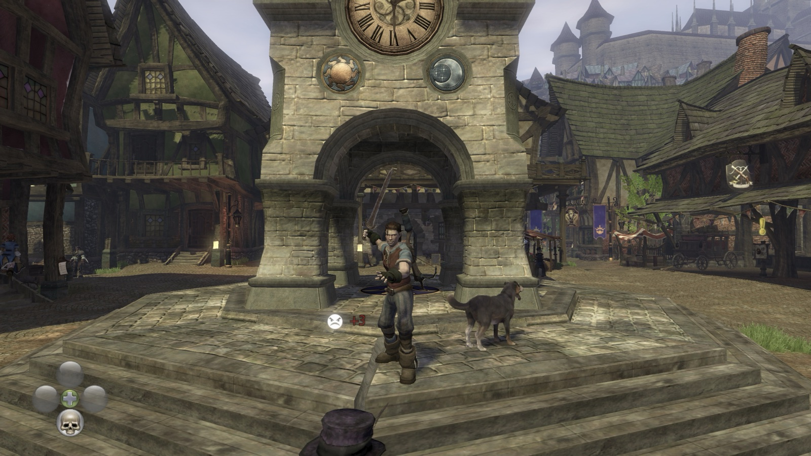

# Fable2RecompMac: Fable 2 for Mac (Apple Silicon)

Play **Fable 2** (Fable II) natively on your Mac: a native macOS port for
Apple Silicon (M1, M2, M3, M4 and newer), not an emulator. The game's Xbox 360
program is statically recompiled to native ARM64 code with the
[ReXGlue SDK](https://github.com/rexglue/rexglue-sdk), and a native renderer
draws its graphics through Metal (via MoltenVK) instead of emulating the Xbox
GPU.

**[Download the latest release](https://github.com/itar3/Fable2RecompMac/releases/latest)**
· [Website](https://itar3.github.io/Fable2RecompMac/)
(a Mac app: install your game, it builds itself, play), or build it from
source.

  

**You need your own copy of the game: a Fable II disc image (`.iso`) and
its Title Update 1** (title updates aren't on the disc; you need the one made
for your disc's media ID). This repository and its download contain no game
files, no recompiled game code and no game shaders: your copy is recompiled
and translated on your Mac.

## Status: 1.2

The whole game is playable on Apple Silicon (tested on an M4 Pro, macOS 27):

- Native renderer at the window's full Retina resolution (or a chosen
  full-screen resolution), with the game's 2x MSAA kept.
- 60 fps nearly everywhere with the 60 fps cap, and more without it: busy
  Bowerstone town averages about 65-75 fps uncapped (M4 Pro, 1.2).
- **Fable 2.app**, a launcher: windowed or full screen, window size or
  resolution, render scale, frame rate cap, VSync, power saving, and
  **Install from ISO** that sets the game up from your disc image, finds the
  matching title update and checks that the result is exactly the program
  this port runs before installing anything.
- Power saving: idle game threads sleep instead of spinning (about one CPU
  core less at the same frame rate).
- A ready-made download: the app installs your game and builds it on your
  Mac by itself, no SDK or Terminal needed.
- Keyboard and mouse (1.1): WASD, mouse camera with adjustable sensitivity,
  mouse buttons for melee and ranged, and every key rebindable in the
  launcher (Key bindings…). A controller works alongside.
- 1.2: faster (the game skips drawing what is hidden, as on the Xbox 360),
  the villager "Set Nickname" freeze fixed (its text box now appears; type
  on the Mac keyboard), and a 40 fps cap for 120 Hz screens.

## What you need

- An Apple Silicon Mac (M1 or newer), macOS 14 or later.
- Your own Fable II disc image (`.iso`) and **title update 1** for your
  disc's media ID (title updates aren't on the disc).
- About 10 GB of free disk space (game files 6.5 GB, build about 1 GB, plus
  room while installing).
- Apple's Command Line Tools: the app offers to install them when they are
  missing (free, a few minutes).

### Which game versions work

The port runs one program: Fable II **0.0.1.33**, a disc's program with title
update 1 applied. The discs checked so far all hold the same base program and
become exactly that program with their own title update 1:

| Disc | Media ID | Disc version | With title update 1 |
|---|---|---|---|
| Game of the Year (Russian) / Games on Demand | `05FBECEA` | 0.0.0.33 | works |
| Game of the Year (English, Polish, Hungarian, Korean, Czech, Slovak, Chinese) | `716F0A0D` | 0.0.0.26 | works |

Other discs very likely work too; the launcher checks any disc and title
update you give it before installing.

## Getting started

### The app (easiest)

1. Download `Fable2RecompMac-<version>-mac-native-arm64.dmg` from
   [Releases](https://github.com/itar3/Fable2RecompMac/releases), open it and
   drag **Fable 2.app** to Applications.
2. Open it the first time. The app isn't signed by Apple (this is a free
   hobby project with no Apple developer account), so macOS blocks it once:
   - **macOS 15 or later:** double-click it, click **Done** in the warning,
     then open **System Settings → Privacy & Security**, scroll down to
     "Fable 2 was blocked…" and click **Open Anyway**.
   - **macOS 14:** right-click (Control-click) the app, choose **Open**, then
     **Open** again.
3. **Install from ISO…**: choose your Fable II disc image. Click **Choose…**
   in the Title update row first and point it at the folder with your title
   update packages; the right one is picked by its media ID.
4. The app then builds the game on your Mac (2 to 15 minutes, once). If the
   Command Line Tools are missing, it opens Apple's installer: install them,
   then click **Build**.
5. Click **Play**.

Everything the app sets up lives in
`~/Library/Application Support/Fable2RecompMac` (game files, build, build
log); saves are in `~/.local/share/Fable2`. On the first visit to each area
after a new install, some things appear a few seconds late while their shaders
are translated; after that they are kept.

### Building from source

1. Install the SDK, get the code, prepare your game files and build:
   [docs/SETUP.md](docs/SETUP.md).
2. Play with the launcher (or from Terminal), options and known problems:
   [docs/RUNNING.md](docs/RUNNING.md).
3. `tools/release/make_release.sh` makes the downloadable app.

The native renderer's design and the Fable II specifics are in
[docs/NATIVE_RENDERER.md](docs/NATIVE_RENDERER.md); `MACOS_NOTES.md` is the
port's working log (findings, fixes and debugging switches).

## Known issues

- Shadows can pop when the camera moves; the Xbox 360 version shows similar
  popping.
- The first launch after a shader change stutters while Metal compiles the new
  pipelines; later launches are smooth.
- New installs: the first visit to an area shows missing or white geometry for
  a few seconds while its shaders are translated (kept for later visits).

## Support

If you'd like to support my work on this port, you can buy me a coffee on
[Ko-fi](https://ko-fi.com/itar3). It's entirely optional: donations support
the time spent on the port, don't unlock anything, and the port stays free.
The game itself is never sold or included.

## Credits

- [Fable2Recomp](https://github.com/Fable2Recomp/Fable2Recomp) by RyzenDew and
  contributors, the Windows recompilation project this port started from.
- [EdgeOfTimeRecomp](https://github.com/goliathret/EdgeOfTimeRecomp), whose
  native renderer this one is adapted from.
- [ReXGlue SDK](https://github.com/rexglue/rexglue-sdk) (based on
  [Xenia](https://xenia.jp)), [plume](https://github.com/zolaware/plume) and
  [XenosRecomp](https://github.com/hedge-dev/XenosRecomp).

Licenses: [LICENSE](LICENSE) (MIT) and
[THIRD_PARTY_NOTICES.md](THIRD_PARTY_NOTICES.md).

## Disclaimer

Fable, Fable II, Xbox and Xbox 360 are trademarks of Microsoft Corporation.
This project is not affiliated with or endorsed by Microsoft, Xbox Game
Studios or Lionhead Studios. It does not include or distribute any part of
the game.
